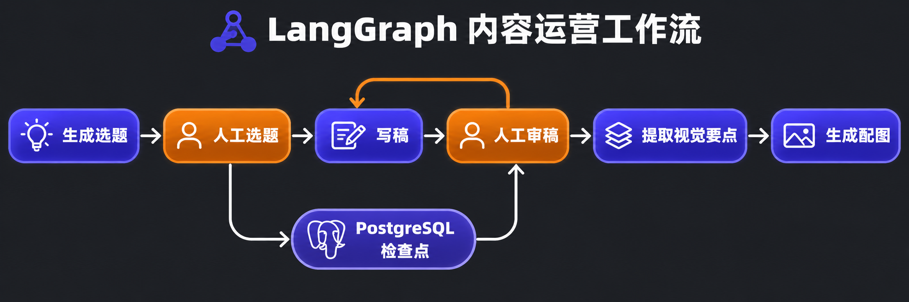

# LangGraph 内容运营助手

**把编辑审核做成工作流的一部分，选题和审稿都能暂停、恢复和返工。**

内容团队需要在写稿前确定方向，也需要控制文案修改和配图投入。项目用 LangGraph 管理工作状态，通过 FastAPI 将选题、编辑决策和生成进度暴露给前端。

## 架构怎么跑

| 阶段 | 实现 |
|---|---|
| 选题 | 选题子图生成候选主题，在人工选择节点调用 `interrupt()` 暂停。 |
| 写稿与审稿 | 写稿后进入第二个人工节点。审核通过进入提取视觉要点，退回时将反馈写入状态并回到写稿。 |
| 状态与恢复 | PostgreSQL 存储检查点，API 按 `thread_id` 查询和继续工作流，并提供流式恢复入口。 |
| 视觉资产 | 从通过审核的文稿提取视觉要点，再调用图片生成节点。 |

**设计取舍**：用状态图表达审核与返工，让前端只需提交人的决定。把配图放在审稿之后，避免为退回草稿生成图片。

## 一篇内容如何从选题走到配图

1. **选题确认**。主图调用选题子图生成候选主题。子图使用 `interrupt()` 等待编辑选择，选择结果保存在当前线程。
2. **有反馈的重写**。写稿节点完成草稿后，审稿节点再次暂停。通过时进入视觉要点提取；退回时把意见放回状态，用 `Command(goto=...)` 路由到写稿节点。
3. **生成视觉资产**。从审核通过的稿件提取视觉要点，再执行图片生成。用于配图的输入来自当前稿件状态。
4. **跨请求继续执行**。API 用 `thread_id` 将前端操作关联到同一次工作流，PostgreSQL 检查点保存运行状态。编辑可在不同请求里读取待处理节点并提交决定。

## 接口怎样对应编辑动作

| 编辑动作 | 读代码时看哪里 |
|---|---|
| 新建一篇内容 | [工作流 API](app/api/v1/workflow.py) 的 `/start` |
| 找到上次停在哪里 | 同一模块的 `/state/{thread_id}`、`/history/{thread_id}` |
| 提交选题或审稿结果 | `/resume/{thread_id}` 和 `/stream/resume/{thread_id}` |
| 查看模型与审核节点之间传了什么 | [状态定义](app/graph/state.py)、[主工作流](app/graph/workflow.py) |

阅读架构时可以沿着「审稿退回 → 修改稿件 → 再次审稿」追踪状态变化。这个分支展示了人工输入、条件路由和检查点如何一起工作。

## 源码入口

- [主工作流](app/graph/workflow.py)和[选题子图](app/graph/subgraphs/topic_selection.py)
- [工作流 API](app/api/v1/workflow.py)
- [Vue 前端](frontend/)

## 本地启动

创建 PostgreSQL 数据库 `aicontent`，按 `.env.example` 配置数据库和模型。根目录运行 `pip install -r requirements.txt` 和 `python -m app.main`，在 `frontend/` 运行 `npm ci` 和 `npm run dev`。

项目基于课程示例代码。
